# EDA — data transaksi SPKLU Bandung 2024 (hasil penyaringan)

> Sumber: `real_data/DATA TRX SPKLU 2024.xlsx` disaring ke **22.514 transaksi** pada 34 SPKLU wilayah Bandung (lihat `step1_filter_spklu.py` dan `step2_filter_transaksi.py`).

## Angka kunci

| Besaran | Nilai |
|---|---|
| Transaksi | 22.514 |
| SPKLU bertransaksi | 34 dari 77 aktif |
| Pengguna unik | 7.025 |
| Energi per sesi | mean 23.43 kWh, median 21.20 kWh |
| Durasi sesi | median 45 mnt, mean 75.66 mnt, maks 1502 mnt |
| Kemiringan durasi | 3.821 (miring kanan) |
| SoC datang | mean 28.3% |
| SoC selesai | mean 56.4% |
| Harga per kWh | median 2466.8 Rp/kWh |
| Jam puncak / lembah | 13:00 / 3:00 |
| Nilai berbeda kolom `hour` | 24 |
| Nilai berbeda kolom `hour_frac` | 19.169 |
| Nilai berbeda kolom `durasi_min` | 642 |

## Catatan penting untuk pemodelan distribusi

1. **Kolom `hour` terlalu kasar.** Ekstraksi lama membuang menit sehingga 22.514 transaksi hanya menempati 24 nilai. Kolom `hour_frac` yang baru mengembalikan resolusi menit dan membuat uji Kolmogorov-Smirnov sah dipakai.
2. **Durasi terpotong engine.** Simulasi membulatkan durasi ke kisi setengah jam lalu memotongnya di 2 jam, sehingga seluruh ekor panjang menumpuk pada satu nilai. Karena itu proses fitting dijalankan pada dua basis terpisah (nilai mentah dan nilai pasca-transformasi) — lihat folder `fitting/`.
3. **Volume stasiun sangat timpang** dan beberapa stasiun dunia simulasi tidak punya transaksi sama sekali, sehingga bobot pemilihan stasiun dihaluskan Laplace.

## Grafik

### 01_jam_bulat.png

Puncak 13:00, lembah 3:00. Hanya 24 nilai berbeda.

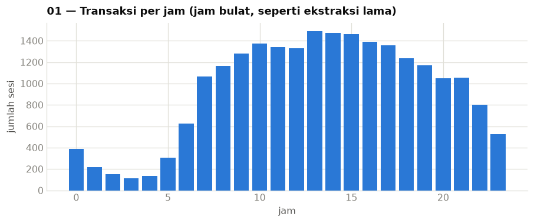

### 02_jam_pecahan.png

19.169 nilai berbeda (bandingkan 24 pada gambar 01). Bentuk harian sama, resolusi jauh lebih halus.

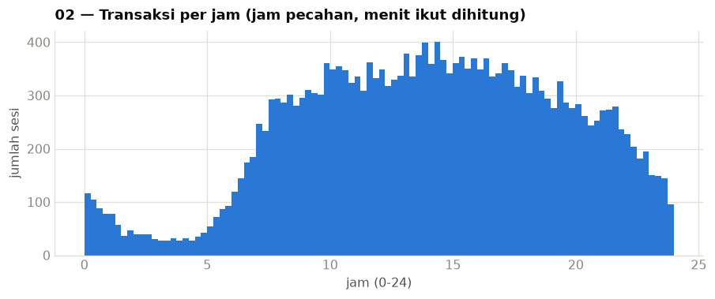

### 03_hari.png

Sebaran hari cukup rata. Kolom ini TIDAK dipakai simulasi — sampler mengulang bentuk harian yang sama untuk setiap hari.

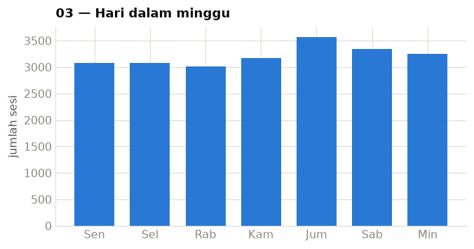

### 04_bulan.png

Tren adopsi sepanjang 2024.

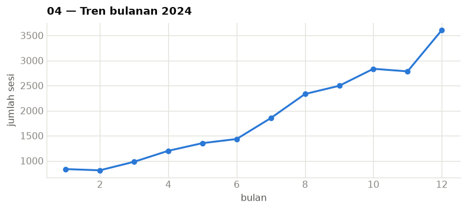

### 05_energi.png

Mean 23.4 kWh, median 21.2 kWh.

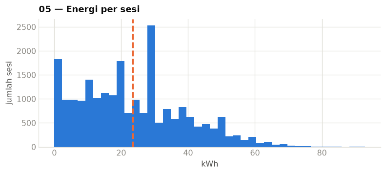

### 06_durasi.png

Miring kanan: median 45 mnt, mean 75.7 mnt, maks 1502 mnt. Engine memotong di 2 jam.

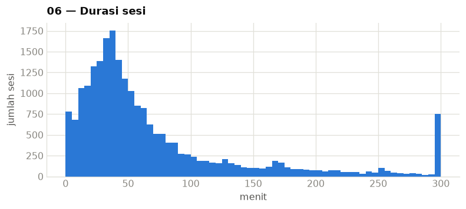

### 07_soc.png

SoC datang mean 28%, SoC selesai mean 56%.

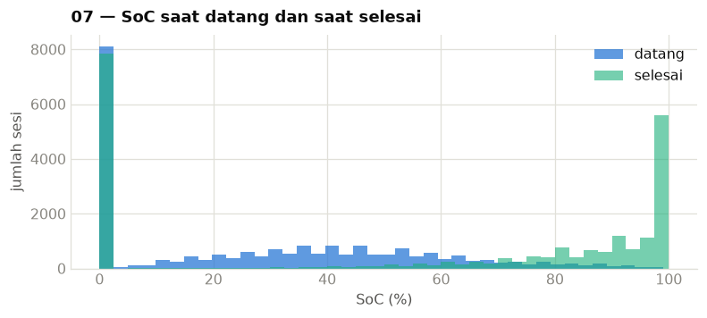

### 08_harga.png

Nyaris flat, median 2466.8 Rp/kWh (tarif PLN). Simulasi hanya memakai mediannya sebagai konstanta.

### 09_volume_stasiun.png

Sangat timpang. Oranye = termasuk 13 stasiun dunia simulasi (semuanya stasiun sepi).

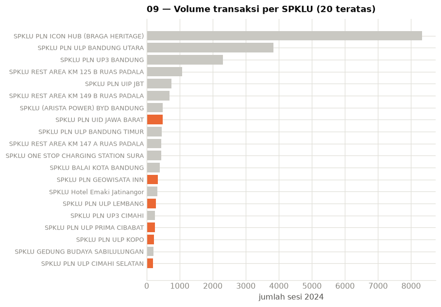

### 10_tier_daya.png

Tier daya yang paling sering dipakai.

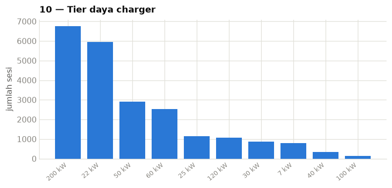

### 11_konektor.png

Jenis konektor. Tidak dipakai simulasi.

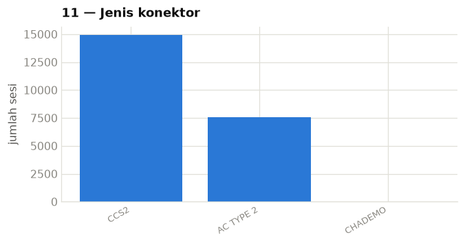

### 12_pengguna.png

7.025 pengguna unik; mayoritas jarang, sedikit sangat sering.

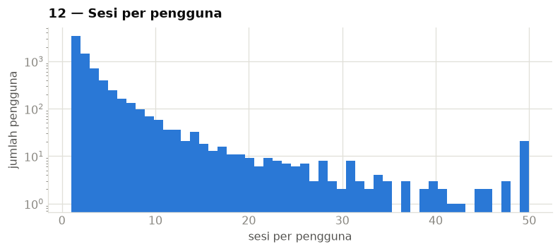

### 13_peta.png

Oranye = 13 stasiun dunia simulasi (dipilih karena port paling sedikit).

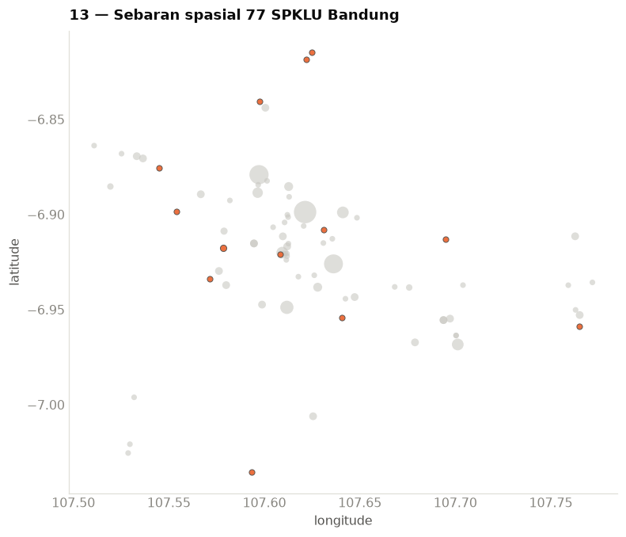

### 14_port_per_stasiun.png

Mayoritas stasiun kecil; sedikit hub besar.

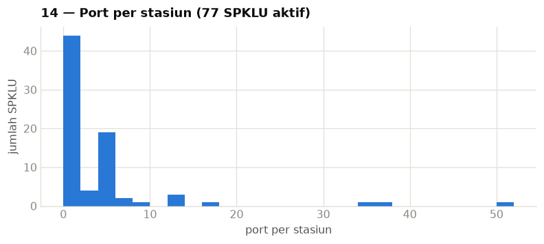

### 15_volume_13_terpilih.png

Total 2.142 sesi sepanjang 2024. 2 stasiun tanpa transaksi sama sekali — inilah alasan bobot stasiun dihaluskan Laplace.

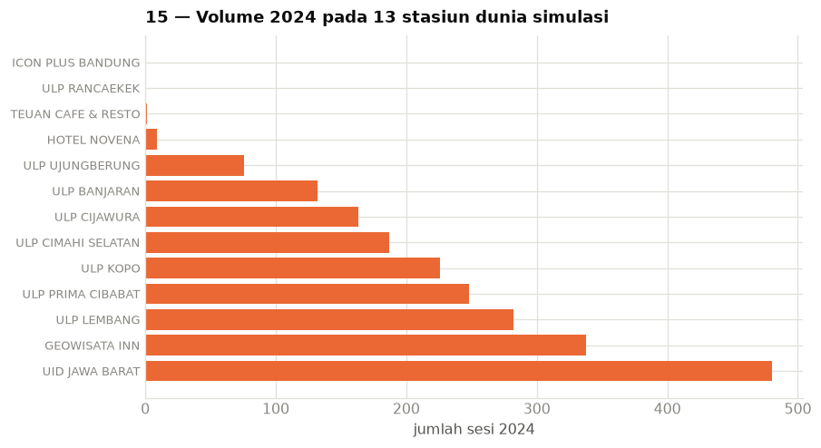
